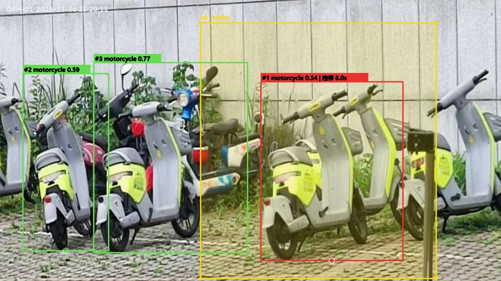
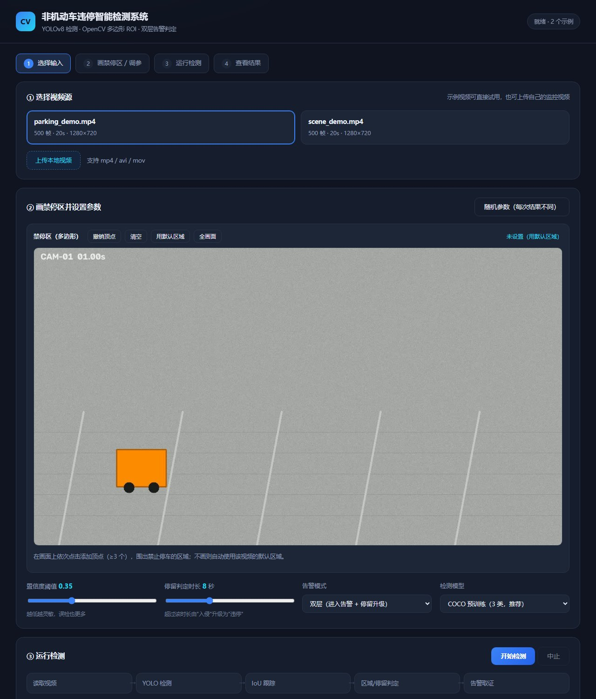

# 非机动车违停智能检测系统

> 基于 YOLOv8 + OpenCV 的禁停区域智能监管：**检测 → 跟踪 → 判定 → 取证** 全链路。
> 面向校园、楼道、地下车库等禁停场景，自动识别违停非机动车并留存证据。

<p align="center">
  
</p>

<p align="center">
  <sub>黄色多边形为禁停区；区域内车辆红色「违停」告警，区域外车辆绿色不告警；白点为判定用的着地点</sub>
</p>

---

## 效果

| 指标 | 数值 | 说明 |
| --- | --- | --- |
| mAP@0.5 | **0.866** | 域对齐微调后，验证集 128 张 / 244 个真值框 |
| 相较 COCO 基线 | **+37.1%** | 基线 0.631（同一评测脚本、同一验证集） |
| 精确率 / 召回率 | 0.860 / 0.802 | — |
| CPU 单帧耗时 | **21 ms**（416 输入） | 约 47 FPS，满足 25 FPS 实时分析 |
| 判定逻辑测试 | 8 / 8 通过 | 单元测试覆盖进入、升级、离开重进、冷却、类别过滤等 |

---

## 快速开始

```bash
# 1. 安装依赖（Python 3.10+）
pip install -r requirements.txt

# 2. 下载预训练权重（约 6 MB，自动尝试多个源）
python tools/get_weights.py

# 3. 跑示例视频
python main.py --source samples/demo_short.mp4
```

运行后按 `Q` 或 `ESC` 退出，产物在 `outputs/`：

```
outputs/
├── screenshots/alarm_*.jpg    # 告警截图（带框、区域、横幅）
├── alarms.csv                 # 结构化告警日志
└── annotated.mp4              # 标注视频（需 --save-video）
```

### 网页演示版

```bash
python web/server.py          # 打开 http://127.0.0.1:8123
```

四步流程：选择视频 → **在画面上点几下画禁停区** → 运行（可见 pipeline 逐段点亮 + 实时预览）→ 结果（告警时间线 + 取证截图 + 标注视频）。

<p align="center">
  
</p>

### 其它用法

```bash
python main.py --source 0                    # 摄像头
python main.py --source my.mp4 --save-video  # 自己的视频 + 导出标注视频
python main.py --source my.mp4 --no-window   # 无界面批量跑（服务器用）
python -m unittest discover -s tests -v      # 单元测试
```

---

## 核心实现

整个系统拆成 4 段，每段职责单一、可独立替换：

```
┌────────┐  ┌──────────┐  ┌──────────┐  ┌──────────┐  ┌──────────┐
│ 视频源  │─▶│  YOLOv8  │─▶│  IoU     │─▶│ 违停判定 │─▶│ 取证可视化│
│文件/相机│  │  检测器   │  │  跟踪器   │  │  状态机   │  │ 截图/CSV │
└────────┘  └──────────┘  └──────────┘  └──────────┘  └──────────┘
```

### 1. 多类别检测

直接使用 COCO 预训练权重检测 `bicycle`(1) / `motorcycle`(3) / `car`(2)。**汽车只检测不告警** —— 它作为干扰项存在，用来证明"告警是按业务规则施加的，不是检测器能力边界"。

### 2. 多边形 ROI 与着地点判定

禁停区是**归一化坐标**的多边形（换分辨率不用重画）：

```json
{ "zones": { "lot_A": [[0.32,0.40],[0.68,0.40],[0.72,0.85],[0.28,0.85]] } }
```

判定不用检测框中心，而用**底边中点**作为车辆着地点（近似车轮触地位置），再交给 `cv2.pointPolygonTest`（内部为射线法）判断是否在区域内：

```python
anchor = ((x1 + x2) / 2, y2)
inside = cv2.pointPolygonTest(polygon, anchor, False) >= 0
```

用中心点会因为框包含车身与骑行者而"悬空"，底边中点才与地面上的禁停区处在同一平面。

### 3. IoU 多目标跟踪

按 IoU 从高到低贪心匹配（阈值 0.30），给每个目标分配稳定 ID，停留时长才能累计在同一目标上。未匹配轨迹超过 `max_age` 帧后注销。固定机位下目标位移小，IoU 已足够，无需引入 DeepSORT 之类重依赖。

### 4. 双层告警状态机

```
OUTSIDE ──落入多边形──▶ INSIDE（累计停留）──连续命中 2 帧──▶ INTRUSION（截图+CSV）
   ▲                        │                                    │
   └────离开，计时清零───────┘                          停留 ≥ 8s ─▶ VIOLATION（截图+CSV）
```

三个防误报机制：

| 机制 | 作用 |
| --- | --- |
| **离开即清零** | 穿过禁停区的车辆不累计时长，不误报违停 |
| **连续命中确认** | 单帧误检不触发告警（默认 2 帧） |
| **独立冷却时间** | 入侵与违停各自 30s 冷却，避免入侵告警压制后续违停升级 |

---

## 目录结构

```
.
├── main.py                  # 命令行入口
├── config.yaml              # 所有可调参数（权重、阈值、区域、输出）
├── src/
│   ├── config.py            # YAML 加载 + 默认值合并 + 路径解析
│   ├── detector.py          # YOLOv8 封装；Mock 检测器用于无权重自测
│   ├── roi.py               # 多边形加载、点内判定、区域绘制
│   ├── tracker.py           # IoU 贪心匹配跟踪
│   ├── judge.py             # 双层告警状态机
│   ├── visual.py            # 检测框/区域/面板/横幅（含中文渲染）
│   ├── writer.py            # 截图与 CSV 落盘
│   └── pipeline.py          # 读帧循环与模块编排
├── tools/                   # 数据集构建、清洗、评测、演示视频生成
├── web/                     # FastAPI 后端 + 原生前端（无 CDN 依赖）
├── tests/                   # 判定逻辑单元测试
├── configs/roi.json         # 禁停区多边形
├── samples/demo_short.mp4   # 10 秒示例视频
└── docs/                    # 运行说明、实验记录
```

---

## 数据集说明

**仓库不包含数据集**（体积原因），代码与文档中说明了完整构建流程：

| 阶段 | 做法 | 工具 |
| --- | --- | --- |
| 获取 COCO | 官网图片托管于境外对象存储，实测仅 14~35 KB/s；改用国内 ModelScope 镜像 | `tools/build_coco_subset.py` |
| 包体过大 | `train2017.zip` 达 18.4 GB，只下载前 2 GB，利用 ZIP 本地头顺序特性流式解析按需抽图 | 同上（`--partial`） |
| 类别筛选 | 保留 `category_id ∈ {2,4}`，剔除 `iscrowd`、过小目标，按图片级划分避免泄漏 | 同上 |
| 域对齐数据 | 中文场景电动车停放 640 张，用 7 条判据清洗（无标签、白底商品图、截图、标注异常、目标过小）+ dHash 去重 | `tools/clean_dataset.py` |

清洗判据里有一条值得一提：**「平坦行占比 > 25%」能有效识别被拉伸过的手机截图**——原始数据里约 20% 是截图和商品图，不清洗会显著拉低指标。

---

### 复现训练

```bash
# 1) 把标注好的 YOLO 格式数据集整理成 train/val 并生成 data.yaml
python tools/build_dataset.py --src data/ebike_scene --out data/parking_yolo \
       --val-ratio 0.15 --seed 42

# 2) 域对齐微调（参数与 docs/实验结果.md 记录一致）
yolo detect train model=yolov8n.pt data=data/parking_yolo/data.yaml \
     imgsz=416 epochs=40 batch=16 lr0=0.002 seed=0 device=cpu
```

两点如实说明：

- 训练中途因关机中断过一次，从 `last.pt` 续训至 40 轮完成；
- 评测用的是仓库内 `tools/eval_compare.py`（同一验证集 128 张 / 244 个真值框、imgsz=416），
  预训练基线按 COCO 的 motorcycle(3) → 数据集 0 重映射后同口径评测。

## 实验记录

### 域对齐微调 vs 预训练基线

| 模型 | mAP@0.5 | 相对基线 |
| --- | --- | --- |
| YOLOv8n 预训练（COCO 80 类） | 0.631 | — |
| YOLOv8n 域对齐微调（1 类） | **0.866** | **+0.234（+37.1%）** |

### 一个反直觉的对照实验

在**同域**数据（COCO 子集，与验证集同分布）上微调，mAP@0.5 只有 **0.551**，反而低于预训练的 0.577。

结论：**微调的收益不来自"训练"这个动作，而来自训练数据与目标场景的分布对齐**。同域时微调等于用更少数据重学同样的分布，性能不升反降；存在域差异时才有显著提升。这个结论对"什么时候该微调"有直接指导意义。

---

## 已知限制

| 限制 | 可能的改进 |
| --- | --- |
| IoU 跟踪在严重遮挡下易断轨 | 引入卡尔曼滤波或 ByteTrack |
| 停留阈值、冷却时间需人工设定 | 按场景自适应，或由历史告警自动标定 |
| 判定逻辑主要在静态图与合成视频上验证 | 采集真实校园监控做长期稳定性测试 |
| 单路视频处理 | 扩展为多路并发 + 告警推送 |
| 禁停区需人工绘制 | 自动生成需语义分割/场景理解，超出当前范围 |

---

## 关于

个人项目，从需求分析到部署独立完成：数据获取与清洗、模型训练与评测、系统实现、网页演示、实验设计。

遇到的问题与解法（部分）：

- **COCO 官网下载龟速** → 换 ModelScope 镜像，10 MB/s
- **训练包 18.4 GB** → 流式解析截断 ZIP，只取需要的图
- **`cv2.imwrite` 写中文路径静默失败** → 改用 `imencode` + 文件流
- **`cv2.putText` 不支持中文** → PIL + TrueType 字体绘制后转回
- **入侵告警占用冷却，压制违停升级** → 两类告警各自维护独立冷却时间戳

---

## License

MIT（代码）。使用的 YOLOv8 权重与 Ultralytics 框架遵循其 AGPL-3.0 许可。

## 致谢

- [Ultralytics YOLOv8](https://github.com/ultralytics/ultralytics)
- [OpenCV](https://opencv.org/)
- COCO 数据集与 ModelScope 镜像
